# 🕯️ Estudo Bíblico Pessoal PWA

> *"Lâmpada para os meus pés é a tua palavra e luz para o meu caminho."* — Salmos 119.105

Aplicativo web progressivo (**PWA**), estritamente **Local-First**, interativo e acessível, que digitaliza os **12 Métodos de Estudo Bíblico Sozinho** (baseados no clássico de Rick Warren) organizados pedagogicamente sob a jornada do **Tabernáculo Bíblico** (*Átrio Exterior*, *Lugar Santo* e *Santo dos Santos*).

Projetado com foco em privacidade total, constância espiritual sem culpa, gamificação pela graça e excelência técnica segundo as normas **ISO/IEC 25010** e **WCAG 2.1 AA**.

---

## 🏛️ A Jornada do Tabernáculo e os 12 Métodos

Os 12 métodos bíblicos são divididos em 3 níveis de profundidade espiritual e exegética:

```mermaid
flowchart LR
    subgraph Atrio["Átrio Exterior (Fundamentos)"]
        M1["01. Método Devocional\n(Acróstico PAPELMOVE)"]
        M2["02. Resumo de Capítulo\n(5 Leituras & 10 Passos)"]
    end

    subgraph LugarSanto["Lugar Santo (Edificação & Contexto)"]
        M3["03. Qualidade de Caráter\n(Matriz Virtude/Defeito)"]
        M4["04. Temático\n(Perguntas de Kipling)"]
        M5["05. Biográfico\n(Linha do Tempo Cronológica)"]
        M6["06. Por Tópicos\n(Esboço Hierárquico I/A/1)"]
        M7["07. Morfológico\n(Léxico Strong Hebraico/Grego)"]
        M8["08. Histórico-Cultural\n(Matriz dos 4 Cenários)"]
    end

    subgraph SantoDosSantos["Santo dos Santos (A Grande Trilogia Exegética)"]
        M9["09. Investigativo do Livro\n(Quadro Horizontal)"]
        M10["10. Analítico de Capítulo\n(Apêndice F & Exegese)"]
        M11["11. Sintético do Livro\n(Esboço Mestre & Discipulado)"]
        M12["12. Versículo por Versículo\n(Quadro de 6 Colunas)"]
    end

    Atrio --> LugarSanto --> SantoDosSantos
```



### 📋 Métodos e Palavras de Incentivo dos Personagens Bíblicos

Ao concluir qualquer um dos 12 métodos, além da celebração visual de confetes dourados e do **toque suave do Shofar** (`/toque-shofar.mp3`), o estudante é agraciado com uma palavra de esperança e incentivo associada à essência do método:

| # | Método | Nível do Santuário | Personagem Bíblico | Princípio & Citação |
| :---: | :--- | :---: | :---: | :--- |
| **01** | **Devocional** | Átrio Exterior | **Tiago** | *"Aproximem-se de Deus, e ele se aproximará de vocês! Sejam praticantes da palavra, e não apenas ouvintes."* (Tg 4.8; 1.22) |
| **02** | **Resumo de Capítulo** | Átrio Exterior | **Salomão** | *"Adquira a sabedoria, adquira o entendimento! O caminho dos justos é como a luz da aurora."* (Pv 4.5,18) |
| **03** | **Qualidade de Caráter** | Lugar Santo | **Paulo** | *"O fruto do Espírito é amor, alegria, paz, paciência... Não nos cansemos de fazer o bem!"* (Gl 5.22-23; 6.9) |
| **04** | **Temático** | Lugar Santo | **Bereanos (Lucas)** | *"Examinem as Escrituras todos os dias para confirmar a verdade. Vocês me acharão quando me procurarem de todo o coração!"* (At 17.11; Jr 29.13) |
| **05** | **Biográfico** | Lugar Santo | **Autor aos Hebreus** | *"Cercados por tão grande nuvem de testemunhas, corramos com perseverança com os olhos fitos em Jesus!"* (Hb 12.1-2) |
| **06** | **Por Tópicos** | Lugar Santo | **Esdras** | *"Dedique o coração a buscar a Lei do Senhor, a praticá-la e a ensiná-la. A boa mão de Deus esteve sobre nós!"* (Ed 7.9-10) |
| **07** | **Morfológico (Palavras)** | Lugar Santo | **Jeremias** | *"Quando as tuas palavras foram encontradas, eu as comi; elas foram para mim o regozijo e a alegria do meu coração!"* (Jr 15.16) |
| **08** | **Histórico-Cultural** | Lugar Santo | **Neemias** | *"Leram claramente no livro da Lei de Deus e deram o sentido... A alegria do Senhor é a vossa força!"* (Ne 8.8,10) |
| **09** | **Investigativo do Livro** | Santo dos Santos | **Moisés** | *"As coisas encobertas pertencem ao Senhor, mas as reveladas pertencem a nós e aos nossos filhos para sempre!"* (Dt 29.29) |
| **10** | **Analítico de Capítulo** | Santo dos Santos | **Davi** | *"Abre os meus olhos para que eu veja as maravilhas da tua lei! Desejo os teus preceitos mais do que o ouro refinado!"* (Sl 119.18,72) |
| **11** | **Sintético do Livro** | Santo dos Santos | **João** | *"Estes foram escritos para que vocês creiam que Jesus é o Cristo, o Filho de Deus, e tenham vida em seu nome!"* (Jo 20.31; Fp 1.6) |
| **12** | **Versículo por Versículo** | Santo dos Santos | **Pedro** | *"Temos a palavra profética confirmada, à qual vocês fazem bem em prestar atenção, como a uma luz que brilha em lugar escuro!"* (2 Pe 1.19) |

---

## ⭐ Principais Recursos e Diferenciais

- 🔒 **Arquitetura 100% Local-First:** Todos os estudos bíblicos, notas e indicadores de progresso ficam gravados no seu próprio dispositivo através do **IndexedDB** ([lib/db/index.ts](file:///c:/workspace/estudobiblicopessoal/lib/db/index.ts)), sem necessidade de contas, telemetria invasiva ou conexão com a nuvem.
- 🎯 **A Regra de Ouro dos 4Ps:** Validador hermenêutico presente em todos os métodos que exige aplicações *Pessoais* (em 1ª pessoa), *Práticas* (ação concreta), *Possíveis* (realistas com a graça) e *Mensuráveis* (com prazo definido).
- 🕯️ **Menorá de 7 Chamas (Streaks da Graça):** Contabiliza 1 chama por dia distinto com estudo concluído. Se você pausar por alguns dias, o streak **não é zerado com culpa** — a Menorá entra em *Brasa Suave da Graça*, encorajando o retorno à intimidade com Deus.
- 🏆 **Santuário & Relicário de Insígnias:** 6 insígnias bíblicas desbloqueadas conforme a constância e abrangência dos estudos (*Discípulo de Bereia*, *Detetive da Palavra*, *Consolador de Almas*, *Guerreiro de Oração*, *Mestre Construtor* e *Chama Perpétua*).
- 📖 **Diário com Leitor Formatado e Texto Puro:** Modal integrado no Diário de Estudos ([components/study/study-viewer-modal.tsx](file:///c:/workspace/estudobiblicopessoal/components/study/study-viewer-modal.tsx)) permitindo alternar entre visualização formatada por etapas ou em texto contínuo, com cópia em 1 clique.
- 📄 **Exportação Multipágina em PDF:** Motor próprio ([lib/export/study-formatter.ts](file:///c:/workspace/estudobiblicopessoal/lib/export/study-formatter.ts)) que gera documentos `.pdf` elegantes com cabeçalho azul e dourado do Tabernáculo, seções detalhadas do método, metadados e acentuação completa em português sem bibliotecas pesadas de terceiros.
- 📝 **Exportação Markdown para Obsidian & Notion:** Gera arquivos `.md` individuais estruturados com YAML frontmatter e seções das etapas do estudo.
- 💾 **Backup Atômico & Restauração JSON:** Exportação e restauração transacional completa com validação rigorosa via schemas Zod ([lib/backup/backup-service.ts](file:///c:/workspace/estudobiblicopessoal/lib/backup/backup-service.ts)).
- 📱 **PWA Instalável & Offline:** Manifest W3C ([app/manifest.ts](file:///c:/workspace/estudobiblicopessoal/app/manifest.ts)), Service Worker Network-First ([public/sw.js](file:///c:/workspace/estudobiblicopessoal/public/sw.js)) e atalhos na tela inicial do celular, tablet ou desktop.
- ⚙️ **Página Central de Configurações:** Acessível pelo ícone de engrenagem no cabeçalho ([app/configuracoes/page.tsx](file:///c:/workspace/estudobiblicopessoal/app/configuracoes/page.tsx)), centralizando instalação, backups, ativação do armazenamento persistente (`navigator.storage.persist()`) e recálculo de progresso.
- 📜 **Cortina do Princípio (Principle Drawer):** Tutoriais contextuais acoplados a cada etapa ([components/study/principle-drawer.tsx](file:///c:/workspace/estudobiblicopessoal/components/study/principle-drawer.tsx)) revelando o "porquê teológico" de cada campo e exemplos práticos.

---

## 🛠️ Tecnologias Utilizadas

- **Framework Web:** [Next.js 16 (App Router)](https://nextjs.org/) com [React 19](https://react.dev/) e compilador Turbopack.
- **Estilização & Design System:** [Tailwind CSS v4](https://tailwindcss.com/) com paleta sagrada inspirada nos tecidos e metais do Tabernáculo (Ouro `#C5A059`, Azul `#1B2A4A`, Púrpura `#5C2A6B`, Carmesim `#8B1E3F`, Linho Fino `#FDFBF7`).
- **Banco de Dados Local:** [Dexie.js](https://dexie.org/) (Wrapper reativo do IndexedDB) com hook `useLiveQuery`.
- **Validação de Tipos e Schemas:** [Zod](https://zod.dev/) e [TypeScript 5](https://www.typescriptlang.org/) em modo estrito (`strict: true`).
- **Ícones e Celebração:** [Lucide React](https://lucide.dev/) e [Canvas Confetti](https://www.npmjs.com/package/canvas-confetti).
- **Testes Automatizados:** [Vitest](https://vitest.dev/) e [Testing Library](https://testing-library.com/) com suporte a JSDOM e `fake-indexeddb`.

---

## 🚀 Como Executar o Projeto Localmente

### Pré-requisitos
- **Node.js** v20 ou superior
- **npm**, **pnpm** ou **yarn**

### 1. Clonar o repositório
```bash
git clone https://github.com/seu-usuario/estudobiblicopessoal.git
cd estudobiblicopessoal
```

### 2. Instalar as dependências
```bash
npm install
```

### 3. Iniciar o servidor de desenvolvimento
```bash
npm run dev
```

Abra [http://localhost:3000](http://localhost:3000) no seu navegador para navegar pelo Tabernáculo.

### 4. Executar os testes automatizados
```bash
npm run test
```
*Executa a suíte de 16 arquivos de teste e 73 testes unitários e de integração com Vitest.*

### 5. Compilar para produção
```bash
npm run build
npm run start
```

---

## 📁 Estrutura de Diretórios

```plaintext
estudobiblicopessoal/
├── app/                              # App Router do Next.js 16
│   ├── configuracoes/page.tsx        # Central de Configurações, PWA e Backup
│   ├── diario/page.tsx               # Meu Diário de Estudos Bíblicos
│   ├── estudo/[methodId]/[studyId]/  # Rota unificada dos 12 Wizards de Estudo
│   ├── santuario/page.tsx            # O Santuário de Constância & Relicário
│   ├── globals.css                   # Tokens de cores do Tabernáculo e tema
│   ├── icon.svg                      # Ícone vetorial da Menorá
│   ├── layout.tsx                    # Shell com Header, Fontes e SwRegistrar
│   ├── manifest.ts                   # Web App Manifest W3C do PWA
│   └── page.tsx                      # Portal do Tabernáculo (Catálogo de Métodos)
├── components/                       # Componentes React modulares
│   ├── brand/                        # Logo e ícones sagrados da Menorá
│   ├── navigation/                   # Cabeçalho com Menorá e navegação
│   ├── pwa/                          # Botão de instalação e registro do SW
│   ├── settings/                     # Painel visual da página de Configurações
│   ├── study/                        # Os 12 Wizards, Modais, Leitor e Gaveta
│   └── ui/                           # Componentes de base (Button, Card, Dialog...)
├── lib/                              # Regras de negócio, banco e utilitários
│   ├── constants/                    # Metadados dos 12 métodos e frases bíblicas
│   ├── db/                           # Definição e instâncias do Dexie IndexedDB
│   ├── export/                       # Gerador de PDF e formatador de texto
│   ├── gamification/                 # Motor da Menorá, Streaks, Insígnias e Shofar
│   ├── storage/                      # Persistência de dados e estimativas de cota
│   └── types/                        # Schemas Zod e tipos do domínio bíblico
├── public/                           # Assets públicos precacheados pelo PWA
│   ├── icons/                        # Ícones da Menorá 192px e 512px (PNG/SVG)
│   ├── sw.js                         # Service Worker PWA com cache offline
│   └── toque-shofar.mp3              # Áudio suave de celebração ao concluir estudo
├── test/                             # 16 Suítes de testes unitários e integração
└── docs/                             # Documentação técnica e plano de engenharia
```

---

## 📚 Documentação Técnica de Engenharia

Para entender os fundamentos de arquitetura, decisões técnicas (ADRs) e requisitos do sistema, consulte os documentos no diretório [`docs/engenharia/`](file:///c:/workspace/estudobiblicopessoal/docs/engenharia/README.md):

- [00. Visão Geral & Sumário Executivo](file:///c:/workspace/estudobiblicopessoal/docs/engenharia/00-visao-geral-e-sumario-executivo.md)
- [01. Requisitos & Regras de Negócio](file:///c:/workspace/estudobiblicopessoal/docs/engenharia/01-requisitos-e-regras-de-negocio.md)
- [02. Arquitetura de Software & Local-First](file:///c:/workspace/estudobiblicopessoal/docs/engenharia/02-arquitetura-de-software-e-local-first.md)
- [03. Projeto de Banco de Dados & Esquema Físico](file:///c:/workspace/estudobiblicopessoal/docs/engenharia/03-projeto-de-banco-de-dados-e-esquema-fisico.md)
- [04. Design System & Heurísticas de Nielsen](file:///c:/workspace/estudobiblicopessoal/docs/engenharia/04-design-system-e-especificacao-de-telas.md)
- [05. Plano de Implementação e Etapas (Fases 1 a 6)](file:///c:/workspace/estudobiblicopessoal/docs/engenharia/05-plano-de-implementacao-e-etapas.md)

---

## 📜 Licença

Distribuído sob a licença MIT. Consulte `LICENSE` para mais detalhes.
